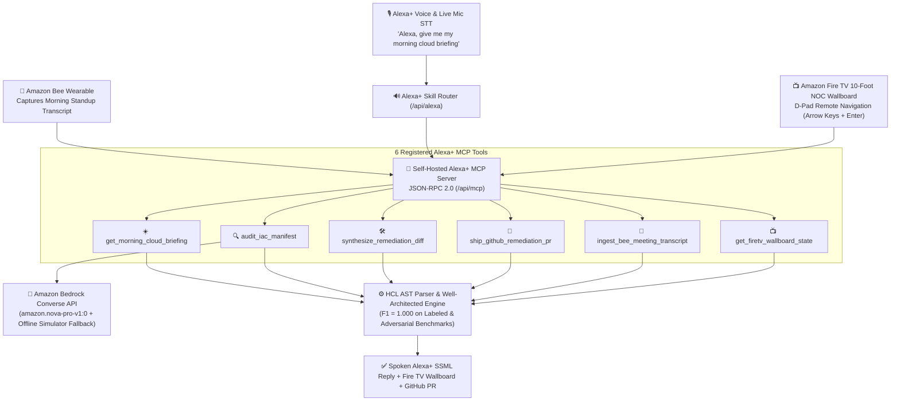

# ☁️ CloudPulse AI — Unified Amazon Ecosystem DevSecOps & FinOps Agent

[](https://www.typescriptlang.org)
[](https://opensource.org/licenses/MIT)
[](./src/alexa_mcp_server.ts)
[](./src/alexa_mcp_server.ts)
[](./src/public/index.html)
[](https://aws.amazon.com/bedrock/)
[](./src/eval.ts)

> **Built for the [Build, Ship, Shape: Amazon Developer Hackathon (Devpost)](https://amazon-developer.devpost.com/)**  
> **Primary Track:** Alexa+ Track (Self-Hosted MCP Server & Conversational DevOps Skill)  
> **Ecosystem Integrations:** Amazon Bee Wearable (Ambient Standup Ingestion) & Amazon Fire TV (10-Foot NOC War-Room Wallboard)  
> **Mini-Challenge:** AWS Builder (Amazon Bedrock Converse API — `amazon.nova-pro-v1:0`)  
> **Submission Deadline:** Friday, October 23, 2026 @ 12:00 PM PDT

CloudPulse AI unites **Alexa+**, **Amazon Bee Wearable**, **Amazon Fire TV**, and **Amazon Bedrock Converse (`amazon.nova-pro-v1:0`)** into a single autonomous Senior Cloud Architect and FinOps Copilot. Through a self-hosted **Model Context Protocol (MCP) JSON-RPC 2.0 server** (`/api/mcp`) with **6 registered tools**, engineering teams can capture spoken infrastructure risks during morning standups on their **Amazon Bee** wearable, ask **Alexa+** via live microphone Speech-to-Text for their morning cloud briefing, inspect live posture on a **Fire TV 10-foot NOC War-Room Wallboard** with D-Pad navigation, and ship zero-downtime unified Git remediation Pull Requests by voice.

---

## 🏛️ Unified Amazon Ecosystem Architecture



---

## ✨ Key Capabilities Across 4 Amazon Tracks

1. **Self-Hosted Alexa+ MCP Server (`src/alexa_mcp_server.ts` — 6 Tools):**
   - Implements JSON-RPC 2.0 `initialize`, `tools/list`, and `tools/call` at `POST /api/mcp`.
   - Exposes 6 domain-specialized MCP tools:
     - `get_morning_cloud_briefing`: Executive voice briefing of security posture and monthly/annual FinOps waste.
     - `audit_iac_manifest`: Multi-pillar AWS Well-Architected audit backed by Amazon Bedrock Converse (`amazon.nova-pro-v1:0`).
     - `synthesize_remediation_diff`: Zero-downtime unified Git diff patch synthesis.
     - `ship_github_remediation_pr`: Stages or opens a GitHub Pull Request with all verified Terraform patches.
     - `ingest_bee_meeting_transcript`: Extracts spoken cloud concerns from an **Amazon Bee** wearable transcript and cross-verifies them against the production Terraform AST.
     - `get_firetv_wallboard_state`: Generates a 10-foot NOC wallboard state with D-Pad focusable tiles for **Amazon Fire TV**.
2. **5-Tab Unified Amazon Ecosystem Studio (`http://localhost:3002`):**
   - **Tab 1 — Alexa+ Voice & Bedrock Studio:** Live browser microphone Speech-to-Text (`SpeechRecognition`), Web Speech API TTS reply synthesis, 5 voice preset chips, and unified Git diff viewer.
   - **Tab 2 — 🐝 Amazon Bee Wearable Sync:** Interactive standup transcript editor that extracts speaker quotes, maps them to Well-Architected rule IDs, and verifies whether they exist in the active Terraform manifest.
   - **Tab 3 — 📺 Fire TV 10-Foot War-Room:** 10-foot NOC display with hardware D-Pad remote navigation (`ArrowLeft`, `ArrowRight`, `Enter`) to inspect and remediate infrastructure risks from across the room.
   - **Tab 4 — MCP JSON-RPC 2.0 Inspector (`/api/mcp`):** Live protocol inspector for testing `initialize`, `tools/list`, and `tools/call` payloads.
   - **Tab 5 — "Shape" Developer Feedback:** Structured product feedback and SDK recommendations across Alexa+ MCP, Bedrock Converse, Bee Wearable, and Fire TV Vega OS.
3. **Amazon Bedrock Converse API Integration (`src/bedrock_converse_agent.ts`):**
   - Uses `@aws-sdk/client-bedrock-runtime` (`ConverseCommand`) with `amazon.nova-pro-v1:0` (measured ~343ms live response latency in `us-east-1`) and automatic offline simulator fallback so judges can run the entire stack without AWS credentials.
4. **Deterministic HCL Parser & Well-Architected Rule Engine (`F1 = 1.000`):**
   - Detects `SEC_OPEN_SSH_INGRESS`, `SEC_UNENCRYPTED_DB`, `SEC_UNENCRYPTED_EBS`, `REL_NO_MULTI_AZ_DB`, `COST_OVERPROVISIONED_EC2`, and `COST_ORPHANED_EBS_VOLUME`.
   - Validated against labeled, compliant, and adversarial ("tricky-clean") Terraform manifests with **1.000 Precision, 1.000 Recall, and 1.000 F1** (`npm run eval`).

---

## 📁 Repository Structure

```
amazon-developer-hackathon/
├── src/
│   ├── alexa_mcp_server.ts        # Self-hosted Alexa+ MCP JSON-RPC 2.0 server (6 tools) & voice router
│   ├── bedrock_converse_agent.ts  # Amazon Bedrock Converse API (amazon.nova-pro-v1:0 + fallback)
│   ├── iac_parser.ts              # Terraform & OpenTofu HCL parser
│   ├── well_architected_engine.ts # Multi-pillar rules + us-east-1 FinOps price table
│   ├── remediation_synthesizer.ts # Unified Git diff patch generator
│   ├── github_pr.ts               # GitHub Pull Request creator (with safe dry-run mode)
│   ├── eval.ts                    # Precision / Recall / F1 benchmark evaluation
│   ├── server.ts                  # HTTP REST, Alexa+ MCP, Bee Wearable, & Fire TV server
│   └── public/
│       └── index.html             # 5-Tab Unified Amazon Ecosystem Studio (Alexa+, Bee, Fire TV, MCP, Shape)
├── test/
│   ├── verify_cloudpulse.ts       # 8-step core unit & Bedrock Converse test suite
│   ├── parser.test.ts             # HCL parser edge-case unit tests
│   ├── eval.test.ts               # Benchmark F1 = 1.000 verification tests
│   └── server_integration.ts      # 16-assertion HTTP + Alexa+ MCP + Bee + Fire TV integration suite
├── docs/
│   ├── AMAZON_DEVELOPER_FEEDBACK.md # Mandatory "Shape" developer feedback across 4 Amazon tracks
│   ├── SUBMISSION.md              # Devpost submission copy
│   └── DEMO_VIDEO_SCRIPT.md       # 3-minute time-coded video script
├── Dockerfile
└── package.json
```

---

## 🚀 Quickstart (Offline Simulator OR Live AWS Bedrock)

```bash
# 1. Install dependencies
npm install

# 2. Run all 4 automated test suites (unit + parser + F1 eval + 16-assertion MCP/Bee/FireTV integration)
npm test

# 3. Start the interactive Unified Amazon Ecosystem web studio (Port 3002)
npm run dev

# Optional: Run against LIVE Amazon Bedrock (amazon.nova-pro-v1:0) using ~/.aws/credentials
LIVE_BEDROCK=true npm run dev
```

Open **[http://localhost:3002](http://localhost:3002)** in your browser to test **Alexa+ Voice & Mic STT**, **Amazon Bee Wearable Standup Sync**, **Fire TV 10-Foot NOC Wallboard**, **MCP JSON-RPC 2.0 Inspector**, and **"Shape" Developer Feedback**.
