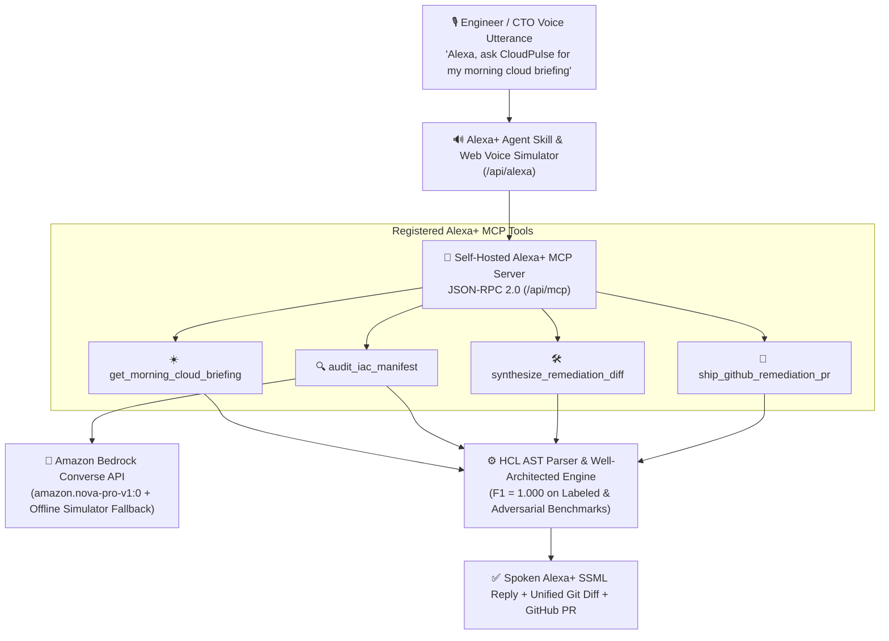

# ☁️ CloudPulse AI — Alexa+ MCP Skill & Amazon Bedrock FinOps Agent

[](https://www.typescriptlang.org)
[](https://opensource.org/licenses/MIT)
[](./src/alexa_mcp_server.ts)
[](https://aws.amazon.com/bedrock/)
[](./src/eval.ts)

> **Built for the [Build, Ship, Shape: Amazon Developer Hackathon (Devpost)](https://amazon-developer.devpost.com/)**  
> **Primary Track:** Alexa+ Track (Self-Hosted MCP Server & Conversational DevOps Skill)  
> **Mini-Challenge:** AWS Builder (Amazon Bedrock Converse API — `amazon.nova-pro-v1:0`)  
> **Submission Deadline:** Friday, October 23, 2026 @ 12:00 PM PDT

CloudPulse AI transforms **Alexa+** into an autonomous Senior Cloud Architect and DevSecOps Copilot. Through a self-hosted **Model Context Protocol (MCP) JSON-RPC 2.0 server** (`/api/mcp`) and the **Amazon Bedrock Converse API** (`amazon.nova-pro-v1:0`), engineering leaders can ask Alexa+ for their morning cloud security & FinOps briefing, run multi-pillar AWS Well-Architected audits on Terraform/OpenTofu HCL, and ship zero-downtime unified Git remediation Pull Requests by voice.

---

## 🏛️ System Architecture (Alexa+ MCP + Amazon Bedrock Converse)



---

## ✨ Key Capabilities

1. **Self-Hosted Alexa+ MCP Server (`src/alexa_mcp_server.ts`):**
   - Implements JSON-RPC 2.0 `initialize`, `tools/list`, and `tools/call` at `POST /api/mcp`.
   - Exposes 4 domain-specialized MCP tools (`get_morning_cloud_briefing`, `audit_iac_manifest`, `synthesize_remediation_diff`, `ship_github_remediation_pr`).
2. **Interactive Alexa+ Voice & Web Simulator (`http://localhost:3002`):**
   - Features 1-click Alexa+ voice preset chips, custom utterance input, browser Web Speech API voice synthesis, and a live **MCP JSON-RPC 2.0 Inspector** tab.
3. **Amazon Bedrock Converse API Integration (`src/bedrock_converse_agent.ts`):**
   - Uses `@aws-sdk/client-bedrock-runtime` (`ConverseCommand`) with `amazon.nova-pro-v1:0` (measured ~343ms live response latency in `us-east-1`) and automatic offline simulator fallback so judges can run the entire stack without AWS credentials.
4. **Deterministic HCL Parser & Well-Architected Rule Engine (`F1 = 1.000`):**
   - Detects `SEC_OPEN_SSH_INGRESS`, `SEC_UNENCRYPTED_DB`, `SEC_UNENCRYPTED_EBS`, `REL_NO_MULTI_AZ_DB`, `COST_OVERPROVISIONED_EC2`, and `COST_ORPHANED_EBS_VOLUME`.
   - Validated against labeled, compliant, and adversarial ("tricky-clean") Terraform manifests with **1.000 Precision, 1.000 Recall, and 1.000 F1** (`npm run eval`).
5. **"Shape" Developer Feedback (`docs/AMAZON_DEVELOPER_FEEDBACK.md`):**
   - Comprehensive product feedback and concrete SDK recommendations for Amazon's Alexa+ MCP and Bedrock Converse engineering teams.

---

## 📁 Repository Structure

```
amazon-developer-hackathon/
├── src/
│   ├── alexa_mcp_server.ts        # Self-hosted Alexa+ MCP JSON-RPC 2.0 server & voice skill router
│   ├── bedrock_converse_agent.ts  # Amazon Bedrock Converse API (amazon.nova-pro-v1:0 + fallback)
│   ├── iac_parser.ts              # Terraform & OpenTofu HCL parser
│   ├── well_architected_engine.ts # Multi-pillar rules + us-east-1 FinOps price table
│   ├── remediation_synthesizer.ts # Unified Git diff patch generator
│   ├── github_pr.ts               # GitHub Pull Request creator (with safe dry-run mode)
│   ├── eval.ts                    # Precision / Recall / F1 benchmark evaluation
│   ├── server.ts                  # HTTP REST & MCP JSON-RPC server
│   └── public/
│       └── index.html             # 3-Tab Alexa+ Voice Studio, MCP Inspector & Shape Feedback UI
├── test/
│   ├── verify_cloudpulse.ts       # 8-step core unit & Bedrock Converse test suite
│   ├── parser.test.ts             # HCL parser edge-case unit tests
│   ├── eval.test.ts               # Benchmark F1 = 1.000 verification tests
│   └── server_integration.ts      # 13-assertion HTTP + Alexa+ MCP integration suite
├── docs/
│   ├── AMAZON_DEVELOPER_FEEDBACK.md # Mandatory "Shape" developer feedback for Amazon teams
│   ├── SUBMISSION.md              # Devpost submission copy
│   └── DEMO_VIDEO_SCRIPT.md       # 3-minute time-coded video script
├── Dockerfile
└── package.json
```

---

## 🚀 Quickstart (Offline Simulator OR Live AWS Bedrock)

```bash
# 1. Install dependencies
npm install

# 2. Run all 4 automated test suites (unit + parser + F1 eval + MCP integration)
npm test

# 3. Start the interactive Alexa+ & Bedrock web studio (Port 3002)
npm run dev

# Optional: Run against LIVE Amazon Bedrock (amazon.nova-pro-v1:0) using ~/.aws/credentials
LIVE_BEDROCK=true npm run dev
```

Open **[http://localhost:3002](http://localhost:3002)** in your browser:
1. Click any **Alexa+ Voice Command** chip (e.g., *"Alexa, give me my morning cloud briefing"* or *"Alexa, fix all violations and ship a GitHub PR"*) to hear Alexa speak the response and watch the MCP tool execute.
2. Switch to the **MCP JSON-RPC 2.0 Inspector (`/api/mcp`)** tab to inspect raw `initialize`, `tools/list`, and `tools/call` payloads.
3. Switch to the **"Shape" Amazon Developer Feedback** tab to review our engineering recommendations for Amazon's Alexa+ and Bedrock teams.
