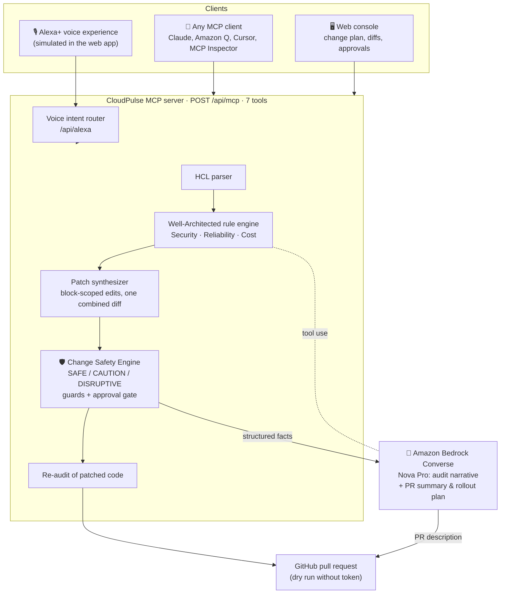
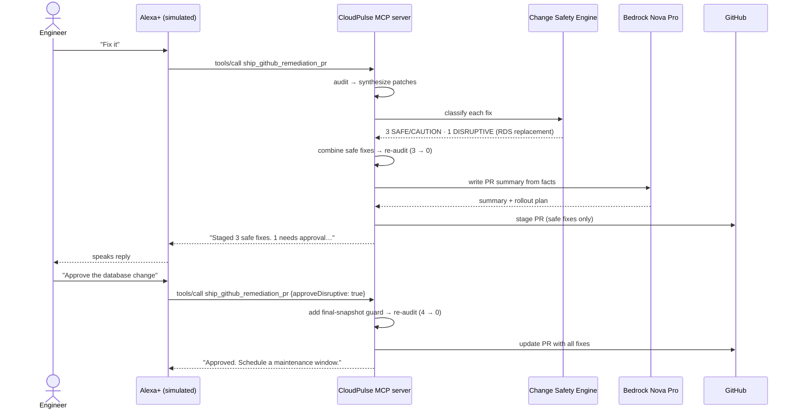
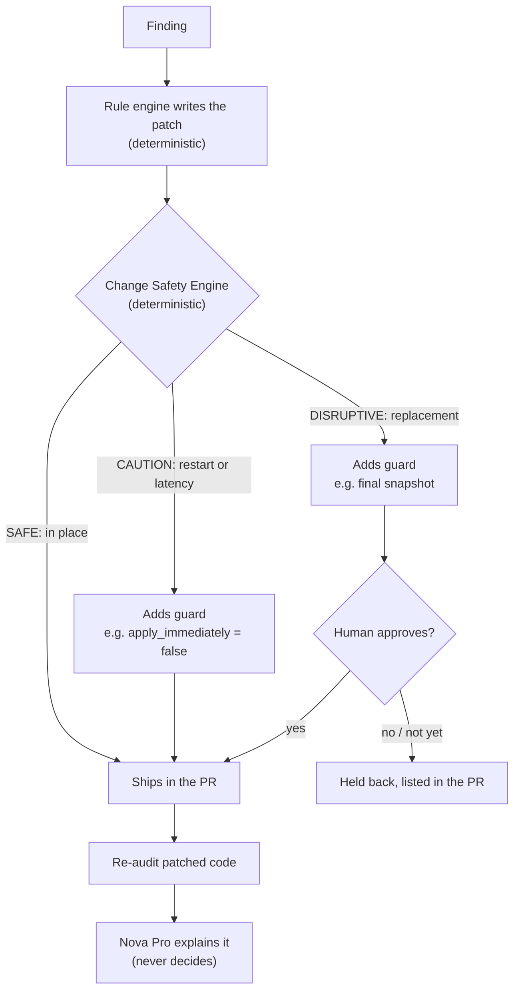

# ☁️ CloudPulse AI — The Alexa+ Cloud Architect That Asks Before It Breaks Things

[](https://www.typescriptlang.org)
[](./LICENSE)
[](./src/alexa_mcp_server.ts)
[](#-verification)
[](./src/bedrock_converse_agent.ts)
[](./test)

> **Built for [Build, Ship, Shape: Amazon Developer Hackathon](https://amazonappdev2026.devpost.com/)**
> **Primary Track:** Alexa+ (self-hosted MCP server + simulated Alexa+ voice experience in a web app)
> **Mini-Challenges:** AWS Builder (Amazon Bedrock Converse, `amazon.nova-pro-v1:0`) • Open Source (MIT)

**CloudPulse AI finds what's wrong in your AWS Terraform, fixes what's safe, and asks you before anything that could cause downtime.** You talk to it through Alexa+, or through any AI assistant that speaks the Model Context Protocol.

---

## 💡 Why this exists

| The problem today | What CloudPulse does instead |
| :--- | :--- |
| Security scanners stop at alerts. Someone still has to find the code, write the fix, and open a PR. | Writes the fix as **one patch that applies with `git apply`**, re-scans the patched code to prove the issues are gone, and stages the PR. |
| Auto-fix tools don't know the **blast radius**. "Turn on RDS encryption" looks like a one-line change, but Terraform will **destroy and recreate the database**. | A **Change Safety Engine** labels every fix SAFE / CAUTION / DISRUPTIVE, adds guards to the patch (e.g. a final snapshot), and **holds disruptive fixes until a human approves**. |
| Voice assistants are bad at *writing* infrastructure changes. | Voice is used for what it's good at: **a briefing, a question, and a yes/no approval**. |

---

## 🎙️ The 30-second demo (real output, lightly shortened)

> **You:** "Alexa, is it safe to fix everything?"
> **CloudPulse:** "3 fixes are safe to ship: closing public SSH/RDP ingress, enabling RDS Multi-AZ, and rightsizing oversized EC2. 1 fix needs your approval, because encrypting the database will replace it. I add a final-snapshot guard, but expect downtime."
>
> **You:** "Fix it."
> **CloudPulse:** "I staged a pull request with 3 safe fixes, saving $420.48 a month. I re-scanned the patched code: 3 issues down to 0. I held back 1 change that needs your approval: encrypting the database will replace it. Say 'approve' to include it."
>
> **You:** "Approve the database change."
> **CloudPulse:** "Approved. The pull request now includes all 4 fixes, including the database replacement, guarded by a final snapshot taken before the old database is deleted. I re-scanned the patched code: 4 issues down to 0. Please schedule a maintenance window before merging."

The pull request description is written by **Amazon Nova Pro** from the structured safety data, and the risk table in it is always generated by code, so the model can't drop or invent a risk.

---

## 👥 Who it's for: use cases

1. **The on-call engineer's morning briefing.** *"Alexa, give me my morning cloud briefing."* What's critical, what it costs, and what can be fixed safely today, in 20 seconds and hands-free.
2. **Safe auto-remediation for platform teams.** One command turns findings into a reviewed-ready PR: one patch, verified by a re-scan, with a rollout plan and a "before you merge" checklist.
3. **Approving risky changes with understanding.** CloudPulse says *what will happen* ("this replaces your database") before anything ships, and the disruptive part waits for an explicit "approve".
4. **Any AI agent, not just Alexa.** The MCP server works with any MCP client (verified with the official MCP Inspector), so the same safety gate protects changes made by Claude, Amazon Q, Cursor, or your own agent. The `ship` tool refuses disruptive fixes unless `approveDisruptive: true` is passed after the user confirms.
5. **Concept: standup → verified change.** A prototype maps spoken concerns in a (sample) standup transcript to rules and checks whether each one really exists in the code.

---

## 🏛️ Architecture



### The "fix it" flow, with the safety gate



### Who decides what



**Design rule: rules decide, AI explains, humans approve.**

---

## 🔌 MCP tools

| Tool | What it does | Read-only |
| :--- | :--- | :---: |
| `get_morning_cloud_briefing` | Spoken summary: critical risks, savings, how many fixes are safe vs need approval | ✅ |
| `audit_iac_manifest` | Bedrock Converse tool-use loop over the rule engine | ✅ |
| `synthesize_remediation_diff` | One applicable unified diff, each fix with its risk assessment | ✅ |
| `assess_change_risk` | **Blast radius**: how AWS applies each fix, downtime, data risk, guards, approval needed | ✅ |
| `ship_github_remediation_pr` | **Safety-gated PR**: ships safe fixes; disruptive ones only with `approveDisruptive: true` | ❌ |
| `ingest_bee_meeting_transcript` | Concept: standup transcript → rules → verified against the code | ✅ |
| `get_firetv_wallboard_state` | Concept: data for a 10-foot team display | ✅ |

---

## ✅ What's real vs. simulated

| Component | Status |
| :--- | :--- |
| MCP server (`/api/mcp`, 7 tools, JSON-RPC 2.0) | **Real.** Passes the official MCP Inspector for all 7 tools, and every tool's output matches its declared `outputSchema` (tested) |
| Change Safety Engine + approval gate | **Real**, deterministic, tested |
| Patches | **Real**: one diff that applies with `git apply`; re-auditing the patched sample leaves 0 findings |
| Amazon Bedrock Converse (`amazon.nova-pro-v1:0`) | **Real** with AWS credentials (audit narrative + PR summary); deterministic template/simulator otherwise |
| Alexa+ voice front end (`/api/alexa`, browser speech in/out) | **Simulated** Alexa+ experience in a web app, as allowed by the Alexa+ track |
| GitHub PR | **Dry run** by default. Live only with `CLOUDPULSE_LIVE_PR=true` and `GITHUB_TOKEN`, and it opens a PR from an existing `cloudpulse/remediation` branch |
| Standup sync, 10-foot display | **Concepts**: sample transcript; browser UI. Not Bee or Fire TV integrations |

---

## 🧪 Verification

```bash
npm test          # 67 assertions across 6 suites
npm run eval      # detection precision / recall / F1 on labeled, clean and adversarial fixtures
npm run mcp:inspect   # official MCP Inspector CLI → tools/list against the running server
```

| Suite | Assertions | What it proves |
| :--- | :---: | :--- |
| `verify_cloudpulse.ts` | 8 | Core engine + Bedrock Converse agent |
| `parser.test.ts` | 4 | HCL parsing edge cases |
| `eval.test.ts` | 6 | F1 = 1.000 on our fixtures, zero false positives on adversarial-clean config |
| `remediation.test.ts` | 7 | In-place edits, one combined diff, zero findings after re-audit |
| `safety.test.ts` | 16 | Risk levels, snapshot guard, same-arch rightsizing, VPC-CIDR inference, PR risk table, strict approval gating |
| `server_integration.ts` | 26 | HTTP + MCP + voice approval flow; every tool output matches its `outputSchema`; `ping`; empty and invalid input |

Detection is measured on fixtures we wrote, so F1 = 1.000 shows the rules work as designed, not coverage of real-world infrastructure.

---

## 🚀 Quickstart

```bash
npm install
npm test
npm run dev                      # http://localhost:3002 (offline simulator, no AWS needed)
LIVE_BEDROCK=true npm run dev    # live Amazon Nova Pro using ~/.aws/credentials

# In a second terminal, connect a real MCP client:
npm run mcp:inspect              # CLI: lists the 7 tools
npx @modelcontextprotocol/inspector   # GUI: transport "Streamable HTTP", URL http://localhost:3002/api/mcp
```

---

## ⚠️ Honest limitations & roadmap

- **Rule coverage:** 9 rules. Next: use Checkov / Trivy for detection and keep CloudPulse for the fix + safety + approval loop.
- **Parser:** regex-based; doesn't evaluate variables, modules, `count`/`for_each`. Next: read `terraform show -json` plans.
- **Blast radius from a real plan:** today the safety rules encode documented AWS behavior. Next: confirm against `terraform plan` (which reports replacements directly).
- **Rightsizing** uses instance size only. Next: CloudWatch / Compute Optimizer utilization.
- **Alexa+:** simulated in the browser. Next: connect the same MCP server to a real Alexa+ Agent Skill.
- **Voice approval state** is kept in memory per server instance (fine for a single-user demo). Next: tie approvals to an authenticated user and expire them.
- **Live Bedrock** is used automatically when AWS credentials are present; set `MOCK_BEDROCK=true` to force the offline simulator.

---

## 📁 Repository structure

```
src/
├── alexa_mcp_server.ts        # MCP server (7 tools), voice intent router, approval flow
├── change_safety.ts           # Change Safety Engine: blast radius, guards, approval gate
├── bedrock_converse_agent.ts  # Bedrock Converse (Nova Pro): audit tool loop + PR description writer
├── remediation_synthesizer.ts # Block-scoped fixes, safety guards, LCS unified diff
├── well_architected_engine.ts # Rules + us-east-1 price table + same-family rightsizing
├── iac_parser.ts              # Terraform HCL / JSON parser
├── github_pr.ts               # GitHub PR (dry run unless CLOUDPULSE_LIVE_PR=true)
├── server.ts                  # HTTP server: /api/mcp, /api/alexa, /api/audit
└── public/index.html          # Web console: voice, change plan, approvals, MCP inspector
test/                          # 6 suites, 67 assertions
docs/                          # Submission text, demo script, product feedback, sample before/after
```

MIT License. See [LICENSE](./LICENSE).
